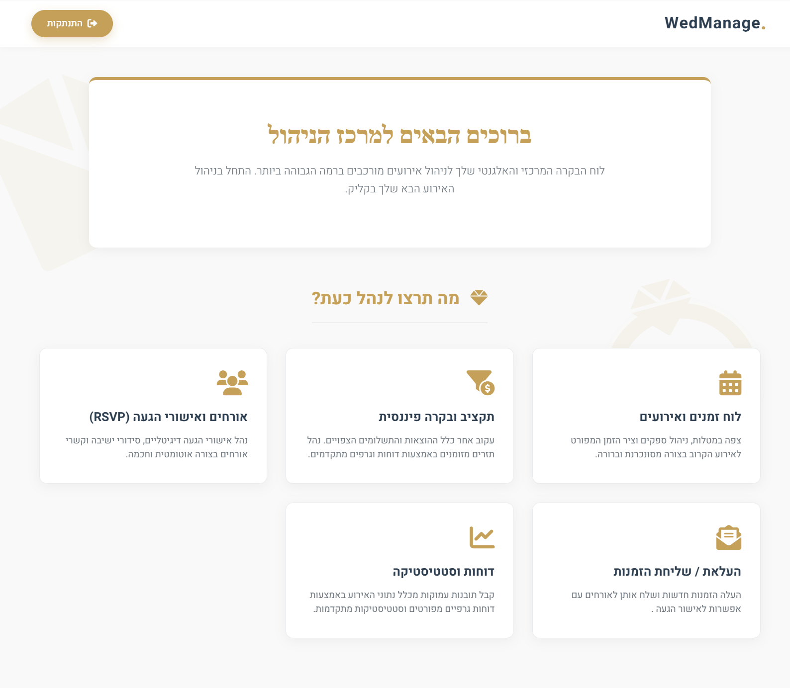
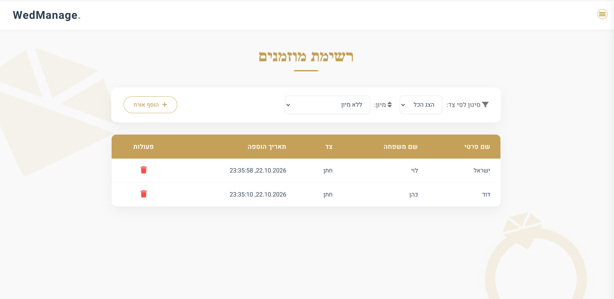
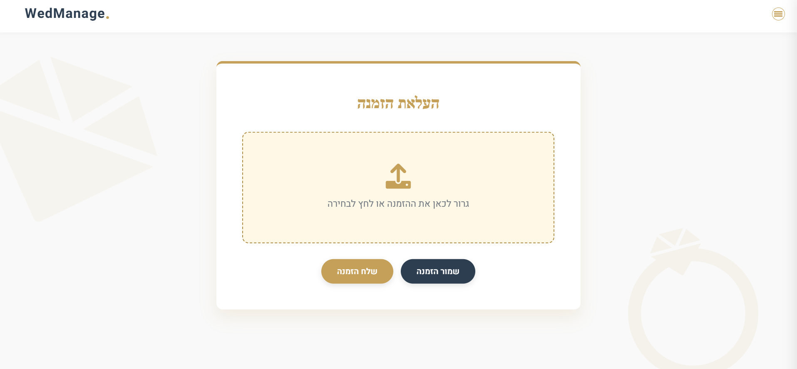
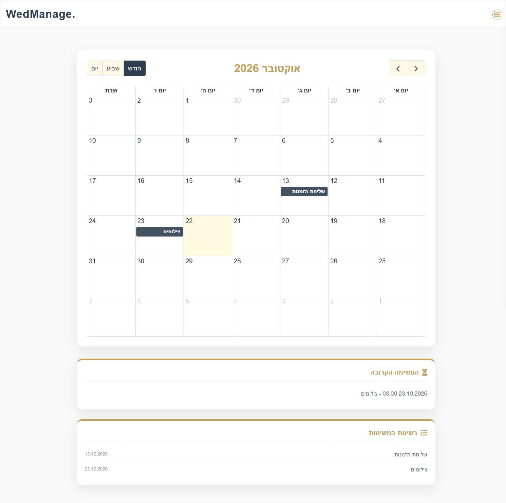
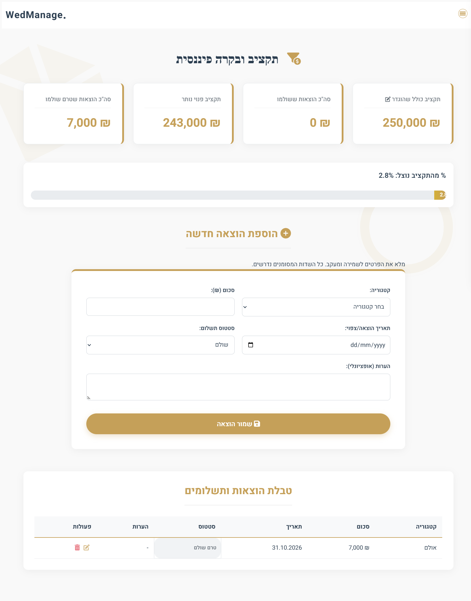
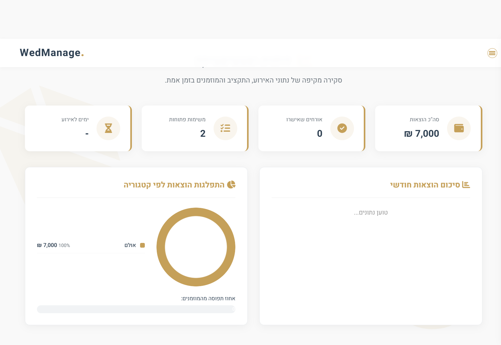

#  WedManage - Full-Stack Wedding Management Platform

 **[Live Demo - Click Here](https://wedding-management-1-ssvh.onrender.com)**

**WedManage** is an end-to-end, full-stack web application developed using Agile methodologies. It empowers couples to seamlessly plan, track, and manage their wedding events—combining real-time financial analytics, dynamic guest management, task scheduling, and automated batch email invitations in one unified platform.

---

##  Key Features

* **Real-Time Analytics & Reports:** Visual KPI cards and dynamic CSS/JS distribution charts summarizing budget usage, RSVP statuses, and open tasks.
* **Financial & Budget Control:** Full CRUD functionality for wedding expenses, categorized tracking, paid vs. pending status calculations, and dynamic budget limits.
* ** Task & Schedule Management:** Interactive calendar and task lists to track wedding planning progress and deadlines.
* **Smart Guest Management:** Organize guests by side (Bride/Groom), filter and sort lists dynamically, and track dietary restrictions and plus-ones.
* **Automated Email Invitations & Reminders:** Upload custom invitation images and dispatch batch or targeted emails to guests, backed by automated reminder services.
* **Secure Authentication:** Complete user registration, login, and password reset flows secured with JWT (JSON Web Tokens) and encrypted passwords.
* **Quality Assurance & CI/CD:** Integrated with **Selenium** for End-to-End (E2E) UI testing and configured with **Azure Pipelines** for continuous integration.

---

## System Architecture & Tech Stack

### Frontend
* **Core:** HTML5, CSS3, Vanilla JavaScript (ES6+)
* **Architecture:** Modular client-side routing, asynchronous Fetch API communication, and responsive custom CSS design.

### Backend
* **Runtime & Framework:** Node.js, Express.js (RESTful API)
* **Database & ORM:** PostgreSQL (Hosted on **Supabase**), Sequelize ORM with relational model associations (`User`, `Guest`, `Expense`, `Task`, `Reminder`, `Message`).
* **Security:** JWT Authentication middleware (`auth.middleware.js`), bcrypt password hashing.
* **Services:** Custom notification and email templating engine (`notificationService.js`, `emailTemplates.js`).

### DevOps & Testing
* **E2E Testing:** Selenium WebDriver (`tests/selenium/test.js`)
* **CI/CD:** Azure DevOps Pipelines (`azure-pipelines.yml`)
* **Cloud Deployment:** Render (Web Service) & Supabase (Cloud PostgreSQL)

---

##  Application Screenshots

###  Guest List & Filtering

###  Custom Invitation Uploader & Batch Sender

###  Task & Schedule Management

###  Financial & Budget Tracker

###  Analytics & Statistical Reports

---

